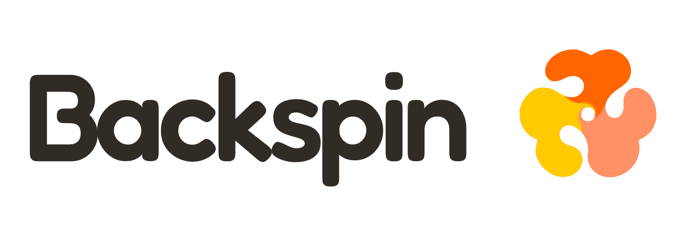

<picture>
  <source media="(prefers-color-scheme: dark)" srcset="docs/assets/backspin-wordmark-dark.png">
  
</picture>

**Less time choosing, more time listening.**

Backspin helps you decide what to play from the records you already own. Connect your Discogs collection, drop the needle, and get one album to put on next.

[Open Backspin](https://backspin.fly.dev) · [Development guide](docs/DEVELOPMENT.md) · [Visual identity](docs/VISUAL_IDENTITY.md)

## Discover your next record

The home screen starts with a spinning vinyl while your collection loads. Once it is ready, **Drop the needle** picks one album, with its artwork, artist, original year when known, and a short explanation when a mood hint influenced the pick. **Try another** shuffles within the same pool without repeating the current album when alternatives exist.

Use **Narrow it down** for three optional filters:

- **Genre** limits the eligible records to that genre.
- **Mood** gives matching genre and style tags more weight. Choose Mellow, Upbeat, Focused, or Adventurous, or leave it at Surprise me.
- **Era** limits the pool by original release decade, using synced years and your personal corrections rather than pressing dates.

Mood is a nudge, not a rule: it never removes an otherwise eligible record. Extra owned copies do not give an album extra chances. Unknown original years stay out of era-specific picks, and an empty pool asks you to adjust the filters instead of silently relaxing them.

## Browse your collection

The **Collection** tab offers:

- Search, sorting, and filters for genres, styles, artists, formats, eras, and Discogs folders.
- Artwork and record details, with optional grouping of owned editions.
- Original-release-year lookup with visible progress, pause, resume, retry, and refresh controls.
- Personal year corrections that stay scoped to your account.
- A last-updated timestamp and an icon to refresh the collection.

Collection snapshots refresh on a five-minute cache cycle. Background refresh keeps the current view in place while the replacement loads; new picks pause until it finishes. Failed refreshes offer a retry. Original master years use a shared SQLite cache, while personal corrections remain separate.

The Backspin name and Citrus icon return you to Discover. The cog opens Settings, where Discogs and Spotify have separate connection status and connect/disconnect controls. Settings closes on an outside tap or Escape.

## Optional Spotify connection

Connect Spotify from Settings to identify your Spotify profile alongside Discogs. Spotify handles sign-in and consent. This stage connects the account only; it does not play music or use listening history, playlists, or saved music to make picks.

Spotify setup requires a developer app, registered callback URLs, and app credentials. Follow the [Spotify setup guide](docs/SPOTIFY.md) for dashboard steps, development-mode user limits, local `127.0.0.1` URLs, and production configuration. The app serves its [privacy and connection details](https://backspin.fly.dev/privacy) at `/privacy` once this integration is deployed.

## Run locally

Use **Node.js 24** and npm.

```sh
git clone https://github.com/Nicholas-Nazario/backspin.git
cd backspin
npm ci
cp .env.example .env.local
```

1. Register an application in [Discogs developer settings](https://www.discogs.com/settings/developers).
2. Set its callback URL to `http://localhost:3000/api/auth/callback`.
3. Fill in `.env.local`:

   | Variable                  | Value                                                                   |
   | ------------------------- | ----------------------------------------------------------------------- |
   | `APP_URL`                 | `http://localhost:3000`; must match your browser origin.                |
   | `DISCOGS_CONSUMER_KEY`    | Your Discogs application's consumer key.                                |
   | `DISCOGS_CONSUMER_SECRET` | Your Discogs application's consumer secret.                             |
   | `SESSION_KEY`             | Generate locally with `openssl rand -hex 32`.                           |
   | `SPOTIFY_CLIENT_ID`       | Optional Spotify app Client ID; see the [setup guide](docs/SPOTIFY.md). |
   | `SPOTIFY_CLIENT_SECRET`   | Optional Spotify app secret; keep server-side.                          |
   | `DATABASE_PATH`           | Defaults to `./data/mystery.sqlite`.                                    |

   Keep credentials in your local environment; `.env.local` is ignored by Git. The database directory and schema are created automatically.

```sh
npm run dev
```

Open [localhost:3000](http://localhost:3000) and connect Discogs. If you use another port, update both `APP_URL` and the Discogs callback URL to match.

## Development

Backspin uses Next.js App Router, React, TypeScript, and SQLite through `better-sqlite3`. Discogs OAuth and API requests run on the server. Fonts are self-hosted; UI icons come from Phosphor.

| Command                                    | Purpose                                                |
| ------------------------------------------ | ------------------------------------------------------ |
| `npm run dev`                              | Start the local development server.                    |
| `npm test`                                 | Run unit and persistence tests.                        |
| `npm run typecheck`                        | Check TypeScript.                                      |
| `npm run build`                            | Build and package the standalone production server.    |
| `npm start`                                | Run the packaged server after a build.                 |
| `npm run format:check`                     | Check formatting of application code and tests.        |
| `npm run backup -- backups/mystery.sqlite` | Back up SQLite; create the `backups/` directory first. |

With the local server running, verify the current recommendation flow and mobile layouts:

```sh
npx playwright install chromium
node --env-file=.env.local --import tsx tests/recommendation.browser.ts
node --env-file=.env.local --import tsx tests/mobile.browser.ts
```

These Playwright fixtures use isolated accounts and intercept Discogs requests. They cover filtering, refresh and error recovery, loading and reveal animations, keyboard interaction, reduced motion, and mobile layout. They do not establish live Discogs behavior. See the [development guide](docs/DEVELOPMENT.md) for collection/year-recovery checks, browser setup, backups, and operational details.

The main implementation lives in:

- `app/recommendation/` — the one-album discovery flow and filter sheet.
- `app/collection/` — collection browsing, details, filters, and year lookup.
- `app/components/` — shared branding, navigation, Settings, and interaction styles.
- `lib/` — selection and filtering rules, Discogs/Spotify transport, sessions, and persistence.
- `public/brand/` — the transparent Citrus SVG; PNG wordmarks for this README are in `docs/assets/`.

## Data and authorization

You authorize each provider through its own sign-in screen; Backspin does not receive your Discogs or Spotify password. Access credentials are held in separate encrypted, HttpOnly session cookies and are not stored in SQLite or localStorage. Discogs sessions last up to eight hours. Spotify connections expire with the access token, usually after an hour; refresh tokens are not retained. Collection snapshots are short-lived and scoped to the authenticated account.

SQLite stores cached original master years, account-scoped year corrections, and expiring OAuth attempt IDs. Disconnecting clears your local session; revoke the application's authorization in Discogs settings to remove its access there.

Album artwork and catalog data come from Discogs. Artwork is displayed without recoloring or cropping. See [third-party notices](THIRD_PARTY_NOTICES.md) for icon and font licenses.

## Deployment and current scope

The hosted app is [backspin.fly.dev](https://backspin.fly.dev). The repository includes a Dockerfile for the standalone Next.js server and a Fly configuration with persistent storage under `/data`. The current request scheduler and collection cache are designed for one application process. Production secrets, database backups, and recovery procedures are covered in the [development and operations guide](docs/DEVELOPMENT.md).

Backspin helps you choose a record; it does not play audio or save listening history. Picks and discovery filters last for the current page visit. Mood hints use catalog metadata, not audio analysis or a learned recommendation model. Spotify account connection is available, while Spotify playback and listening-history recommendations remain outside the current flow.

The older multi-album set builder and illustrated listening room remain in the repository as legacy code, outside the current Discover and Collection experience.
